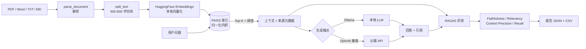

# RAG-Agent · 本地知识库问答与自动评测
[](https://github.com/fzh-creater/rag-agent/actions)
[](./LICENSE)

把一堆 PDF / Word / Markdown 变成本地知识库，回答问题并给出**引用来源**；
同时用 [RAGAS](https://docs.ragas.io/) 把「检索得好不好、回答有没有编」量化成可对比的分数。

> 一个能跑、能测、能解释为什么这样设计的 RAG 工程样例：
> 检索与生成解耦、评测可复现、失败时给出可执行的诊断，而不是一句 `Traceback`。

```text
$ python run_eval.py --retrieval-only

[2] 检索层指标（阈值 0.25）
  #  命中块    Top1相似度     平均相似度       生成(s)    问题
  1  5      0.8081      0.5124      0.0      公司正式员工的试用期是多久？试用期薪资怎么算？
  4  5      0.7645      0.4838      0.0      华东智慧仓储项目原定什么时候上线？为什么延期？
  ...
[3] 检索层汇总
  平均召回块数 : 5.0
  平均 Top1 相似度 : 0.6712
```

---

## English

A local RAG system (LangChain + FAISS + sentence-transformers) with a RAGAS-based
evaluation harness. Retrieval and generation are decoupled: retrieval is local and
free, generation goes through any OpenAI-compatible endpoint (Ollama or a cloud API).
`run_eval.py` scores the pipeline with Faithfulness / Answer Relevancy / Context
Precision / Context Recall, prints a layered diagnostic report, and writes JSON + CSV.
Pure logic lives in `core.py` so CI runs without PyTorch.

---

## 它解决什么问题

多数「RAG demo」停在“能问答”，但真正决定可用性的是四个问题，这个仓库逐个给出答案：

| 问题 | 本仓库的做法 |
|---|---|
| 回答是编的吗？ | `Faithfulness` 逐句核对回答是否被检索到的上下文支持 |
| 检索到的东西有用吗？ | `Context Precision / Recall` 分别衡量“混入噪声”和“漏掉关键信息” |
| 换了文档/模型，效果变好了吗？ | 每次评测落盘 CSV，可横向对比；阈值、top_k 都是显式参数 |
| 为什么跑不起来？ | 生成端点分四层诊断（装没装 / 起没起 / 模型在不在 / Key 对不对），给出可直接复制的命令 |

## 核心能力

- **多格式入库**：PDF / Word / TXT / Markdown，按段落+句末标点切分到 500–800 字，保留文件名与块号
- **中文友好检索**：多语种 MiniLM + 归一化内积（即余弦相似度），阈值可调，附未过滤的原始分数用于调参
- **可插拔生成**：本地 Ollama 或任意 OpenAI 兼容云服务，切换只改环境变量，**不用重建索引**
- **带引用的回答**：每条回答可展开查看命中的文档块、块号、相似度，以及**原文片段**
- **流式输出**：首字延迟从「整段生成时间」压到 1~2 秒，不再白屏
- **数据飞轮**：每次问答落 JSONL，👍/👎 一键反馈，`python qlog.py --export` 把差评导出成待标注的评测集草案
- **重复上传自动去重**：按 `content_hash` 判重，同一份文件传两次不会把 Top-K 占满
- **可复现评测**：10 条带标准答案的问题（含 1 条“知识库里没有”的负样本专测幻觉），输出 JSON + CSV
- **零模型跑测试**：`core.py` 不依赖 torch/faiss，56 个单元测试在 CI 上 1 分钟内跑完

## 架构



`core.py` 只含纯逻辑（切分、提示词拼接、配置解析、诊断文案），
`rag_engine.py` 负责重活（向量化、FAISS），`run_eval.py` 负责评测与报告。
这样 90% 容易写错的地方都能在无模型环境下被测试覆盖。

## 快速开始

### 1. 安装

```bash
git clone <your-repo-url> && cd RAG-Agent
pip install -r requirements.txt
```

> 首次运行会下载约 470MB 的嵌入模型（默认走 hf-mirror 镜像）。
> 想换模型：`export RAG_EMBEDDING_MODEL=BAAI/bge-small-zh-v1.5`（中文检索更强、体积更小）。

### 2. 准备生成模型（二选一）

**A. 云端 API（最快，推荐）**

把 `.env.example` 复制成 `.env`（**已被 .gitignore 排除，不会提交**），填两行即可：

```ini
RAG_LLM_API_KEY=sk-xxxx
RAG_LLM_BASE_URL=https://api.deepseek.com/v1
RAG_CHAT_MODEL=deepseek-chat
```

```bash
python run_eval.py --check-llm      # 先测连通性，1 秒出结果
```

`.env` 会在启动时自动加载；也可以用环境变量（`$env:RAG_LLM_API_KEY="sk-xxxx"`），
环境变量优先级更高。任何 OpenAI 兼容服务都能用（DeepSeek / 通义 / 硅基流动 / OpenAI …），
`.env.example` 里给了三家的现成配置。

**B. 本地 Ollama（离线、免费）**

```bash
# 先安装：https://ollama.com/download
ollama pull qwen2.5:7b        # 约 4.7GB
python run_eval.py --start-ollama
```

### 3. 建库 + 评测

```bash
python run_eval.py --rebuild        # 首次：按 data/samples/ 建索引（也可用 uploads/）
python run_eval.py                  # 完整评测：检索 + 4 个 RAGAS 指标
```

不想配置模型也能先看检索层结果：

```bash
python run_eval.py --retrieval-only
```

### 4. 打开界面

```bash
streamlit run app.py      # 默认 http://localhost:8501
```

页面分两个 Tab：

**💬 智能问答** — 侧边栏上传文档 → 点「构建 / 更新」→ 提问，回答下方可展开引用来源
（文件名 + chunk_id + 相似度）。

**📊 评测报告** — 直接读取 `reports/` 下的评测结果，网页里就能看到：

| 区块 | 内容 |
|---|---|
| 指标卡 | 四个 RAGAS 指标，副标题显示「排除负样本」后的值 |
| 检索层 | 每条问题的命中块数、Top1 相似度、平均相似度，以及命中率汇总 |
| 逐条得分 | 可排序表格，一眼看出哪几条拖后腿 |
| 负样本 | 是否正确拒答（✅ 未编造 / ❌ 可能编造） |
| 诊断建议 | `run_eval.py` 生成的调优建议 |
| 运行评测 | 页面内一键重跑（子进程 + 实时日志回显），跑完自动刷新 |

报告按时间倒序列出，可下拉切换——**跑 `--top-k 3` 和 `--top-k 5` 各一次，就能在网页上直接对比**。
默认自动选中最新一份**带指标**的完整报告，不会被中途的 `--retrieval-only` 结果覆盖。

<details>
<summary>全部命令行参数</summary>

| 参数 | 作用 |
|---|---|
| `--rebuild` | 按 `uploads/`（空则 `data/samples/`）全量重建索引 |
| `--show [N]` | **只读查看最近 N 份历史报告**（默认 1），不重跑、不花钱 |
| `--check-llm` | 只测生成模型连通性，定位 401 / 404 / 模型名错 |
| `--start-ollama` | 后台拉起本地 Ollama 再继续 |
| `--retrieval-only` | 只评测检索层，不需要生成模型 |
| `--full` | 额外评测 `answer_correctness` |
| `--judge-model qwen2.5:14b` | 换裁判模型（7B 偶尔 JSON 不合规时用） |
| `--top-k 5` / `--min-score 0.2` | 检索条数 / 相似度阈值 |
| `--questions my_set.json` | 换评测集 |
| `--doctor` | 环境自检：依赖、生成端点、索引、问题集 |
| `--quiet` / `--out-dir reports` | 少打印 / 报告目录 |

退出码：`0` 成功，`1` 致命错误，`2` 降级为仅检索层。
</details>

## 评测设计

**指标含义与调优方向**

| 指标 | 衡量什么 | 偏低时先改什么 |
|---|---|---|
| Faithfulness | 回答里的陈述能否被上下文支持 | 提示词约束“只依据资料”、降温度、减少上下文条数 |
| Answer Relevancy | 回答是否正面回应问题 | 要求“先给结论”、把问题原样再强调 |
| Context Precision | Top-K 里有多少块真正相关 | 降 top_k、提阈值、加 rerank、缩小 chunk |
| Context Recall | 标准答案所需信息是否被召回 | 提 top_k、放大 chunk、换中文嵌入模型 |

**样本集**：`eval_set.json` 共 10 条，覆盖 5 份示例文档（员工手册、项目复盘、产品规格、
售后政策、数据安全），其中最后一条是**负样本**——问“股票期权计划”，而知识库里根本没有，
用来检验模型是老实说“无法回答”还是编造数字。

**实测（检索层，`data/samples/` 5 篇文档 / 10 个块，阈值 0.25）**

| 指标 | 数值 |
|---|---|
| 命中率（10 题） | 10/10 |
| Top1 相似度 | 0.4739 ~ 0.8081，均值 **0.6712** |
| 平均召回块数 | 5.0（= top_k） |

**实测（RAGAS，裁判模型 DeepSeek-Chat，`top_k=5`，3 次运行）**

| 指标 | 全体均值（10 条） | 运行区间 | 排除负样本（9 条） |
|---|---|---|---|
| Faithfulness 忠实度 | **0.924** | 0.924 – 0.950 | 0.916 |
| Answer Relevancy 回答相关性 | **0.801** | 0.801 – 0.830 | 0.890 |
| Context Precision 上下文精确率 | **0.825** | 0.825（三次一致） | 0.917 |
| Context Recall 上下文召回率 | **1.000** | 1.000（三次一致） | 1.000 |

负样本（“股票期权计划”，知识库里没有）：**正确拒答，未编造**。

> 注意上表的规律：**生成类指标（Faithfulness / Relevancy）会随运行波动 2~3 个点，
> 检索类指标（Precision / Recall）三次完全一致**——因为检索是确定性的，而 LLM 裁判不是。
> 所以做 A/B 对比时，检索指标可以直接比，生成指标必须跑 3 次取均值。

**怎么看历史报告**（三种方式，都不用重新评测）：

```bash
python run_eval.py --show        # 终端里看最近一份完整报告
python run_eval.py --show 3      # 连看 3 份，直接对比不同配置
streamlit run app.py             # 网页看板：指标卡 + 表格 + 多报告对比图
```

也可以直接打开 `reports/` 下的文件：`eval_report_*.json` 是完整过程（每条问题的
检索块、原始相似度、回答、分数），`eval_scores_*.csv` 用 Excel 双击就能开（UTF-8 BOM，不会乱码）。

> ⚠️ **两个必须知道的坑**（也是本仓库把负样本单列的原因）：
>
> 1. **答对反而扣分**：RAGAS 把拒答视为 noncommittal，`answer_relevancy` 直接判 0；
>    上下文里确实没有答案，`context_precision` 也判 0。所以负样本会把总均值压低 6~10 个点，
>    报告里因此额外输出「排除负样本后的均值」（见 `[3b]` 段）。
> 2. **同配置复跑有波动**：同一份数据连跑两次，Faithfulness 分别为 0.944 与 0.924。
>    写论文或做 A/B 对比时，建议固定裁判模型、跑 3 次取均值，别拿单次结果下结论。
>
> 另外做过一次 `top_k=3` 的对照实验：Context Precision 从 0.825 掉到 0.800、
> Context Recall 从 1.000 掉到 0.900——**缩小 top_k 并不能提升精度，反而漏掉上下文**。
> 结论是这份语料上 `top_k=5` 更优，而不是凭直觉调小。

结果写入 `reports/eval_report_*.json` 与 `reports/eval_scores_*.csv`。
报告把「检索层」和「生成层」的指标分开列——**指标掉了先看是哪一层**，

## 数据闭环：让系统自己找到坏例子

评测集是手写的，只能测「我猜用户会问什么」。真实用户的坏问题，靠下面这条链路捞：

```text
每次问答 ──► logs/queries.jsonl      问题 / 命中的块与分数 / 回答 / 各阶段耗时
   │
   ├─ 👍 / 👎 ──► logs/feedback.jsonl  反馈 + 原因（答非所问 / 事实错误 / 信息不完整 / 引用不对）
   │
   └─ 每周 ──► python qlog.py --export ──► logs/bad_cases.json（待标注）
                                              │
                                    人工补 ground_truth
                                              │
                                              ▼
                                  合并进 eval_set.json → 下一轮回归测试
```

用法：

```bash
python qlog.py            # 看概况：问答数、好评率、差评原因分布
python qlog.py --export   # 导出 👎 案例为待标注草案

# 网页里点 👍/👎 即刻落盘，无需额外操作
```

设计上的三个约束（都有单测锁住）：

1. **埋点绝不影响主流程**：写盘失败静默返回，用户仍能正常看到回答；
2. **只存块的 id 与分数，不存原文**：避免日志变成第二份敏感数据；
3. **坏行不拖垮文件**：JSONL 半行（进程被杀）会被跳过，其余照常读。

> `logs/` 已在 `.gitignore` 里——它包含真实的提问内容，不应该进仓库。

而不是笼统地说“效果不好”。

## 设计取舍

1. **检索本地、生成可云**：嵌入模型 470MB 一次下载即可离线复用；生成侧换成 API 只改环境变量。
   如果两者耦合，换模型就得重建整个索引。
2. **阈值默认 0.25，而不是 0.6**：MiniLM 多语种对中文的余弦相似度普遍落在 0.2~0.6，
   实测 0.6 会把所有结果过滤掉（历史版本就踩过：4 个问题全部 0 命中）。
   所以额外暴露 `top_scores()` 输出**未过滤**的原始分布，让调阈值有依据。
3. **加载索引时显式传回 `distance_strategy`**：FAISS 默认按欧氏距离解释分数，
   而建库用的是内积。不传会导致“重启前后同一个库给两种分数量纲”。
4. **评测用旧式指标类 + `evaluate()`**：ragas 0.4.3 里 `evaluate()` 只接受
   `metrics.base.Metric` 子类，`metrics.collections` 的新式指标只配 `@experiment`；
   混用会抛 `TypeError: All metrics must be initialised metric objects`。
   代码里注明了原因与迁移路径，并定向静音了对应的 deprecation 告警。
5. **纯逻辑抽到 `core.py`**：CI 不必安装 2GB 的 torch 就能跑 56 个测试，
   同时保证“诊断文案”这种容易写歪的逻辑有回归保护。
6. **失败要说人话**：模型不可用时区分「没装 / 没启动 / 缺模型 / Key 错」，
   每条都给可复制命令；评测在生成失败时自动降级为检索层报告，而不是整体崩掉。

## 目录结构

```text
.
├── core.py                  # 纯逻辑：切分、提示词、配置解析、分层诊断（无重依赖）
├── rag_engine.py            # 引擎：解析 / 向量化 / FAISS / 检索 / 生成
├── run_eval.py              # 评测：RAGAS 指标 + 分层报告 + JSON/CSV 落盘
├── app.py                   # Streamlit 界面
├── ragas_compat.py          # ragas 0.4.3 与 langchain-community 0.4 的导入兼容补丁
├── eval_set.json            # 评测问题集（含标准答案与负样本）
├── data/samples/            # 示例文档，clone 下来即可试跑
├── tests/                   # 56 个单元测试（不需要模型）
├── docs/CASE_STUDY.md       # 产品视角的一页纸：用户 / 取舍 / 结果 / 不足
├── 诊断报告.md               # 一次真实排障记录：从 TypeError 到指标可信
├── requirements.txt         # 运行依赖
├── requirements-dev.txt     # 测试/CI 依赖
└── .github/workflows/ci.yml # lint + pytest + 无模型冒烟
```

> 只想快速判断这个项目值不值得看？读 [docs/CASE_STUDY.md](docs/CASE_STUDY.md)
> ——一页纸讲清楚「谁用、解决什么、做了哪些取舍、结果如何、哪里还不行」。

## 测试

```bash
pip install -r requirements-dev.txt
pytest -q            # 56 passed
ruff check .
```

CI 只安装 `pytest` 与 `ruff`，不装 torch——这正是把纯逻辑抽出来的收益。

## 常见问题

| 现象 | 原因 | 处理 |
|---|---|---|
| `ollama: command not found` | 没安装（不是没启动） | `winget install Ollama.Ollama`，重开终端；或改用云端 API |
| `TypeError: All metrics must be initialised metric objects` | 用了 `ragas.metrics.collections` 的新式指标 | 用 `ragas.metrics` 的旧式类配 `evaluate()` |
| `ModuleNotFoundError: ...vertexai` | ragas 0.4.3 引用了 langchain-community 0.4 已删除的模块 | 保证 `import ragas_compat` 早于 `import ragas` |
| 指标全是 NaN | 检索 0 命中，或裁判模型没按 JSON 输出 | 看报告里 Top1 分数；换更强的裁判模型 |
| `pip install` 报 GBK 解码错误 | `requirements.txt` 里有中文（Windows pip 用系统编码读） | 该文件保持纯 ASCII |

更完整的排障过程见 [诊断报告.md](诊断报告.md)。

## 已知限制

- 切块按字符长度硬切，长文档可能把一个小节的句子切开；按标题层级切是下一步
- 没有 rerank；Top-K 里的噪声会直接拉低 Context Precision
- 嵌入模型是多语种小模型，中文语义区分度一般（示例里“居家办公”那题 Top1 只有 0.47）
- RAGAS 的 prompt 为英文（0.4.3 默认），中文内容实测可用，但裁判模型能力直接影响分数
- 未做并发检索与缓存；10 条问题的评测在 7B 本地模型上约 3–5 分钟

## Roadmap

- [ ] rerank（bge-reranker）与按标题层级切块
- [ ] 评测集扩到 30+ 条并支持多次重复取均值与置信区间
- [ ] 检索结果缓存与并发
- [ ] 迁移到 ragas 新式 API（`@experiment` + collections）

## License

[MIT](LICENSE)
